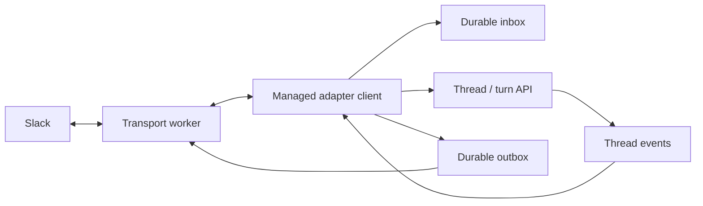

# Managed adapters

Design sketch for replacing the self-agent adapter path. The setup docs live in
[`website/docs-src/adapters/`](../website/docs-src/adapters/index.md). This is not implemented yet;
the work is tracked in [`TODO.md`](../TODO.md#adapters).

## Model

An adapter is a client of an agent. It receives input, opens or resumes a thread,
submits a turn, follows its events, and delivers the response to the originating
chat. The same agent can be used from Slack, the terminal, or an HTTP client.

The adapter owns the external connection and delivery. The provider owns the
thread, sandbox, vault selections, and execution. A harness does not need to know
how to send a Slack message.



## Configuration

Inline configuration belongs in the agent definition:

```yaml
adapters:
  - type: slack
    vault: support-slack
    allowed_channels: [C123456]
```

`type` selects a built-in transport. `name` defaults to `type`; two adapters of the
same type need distinct names. Resolve names before checking duplicates. Options
are specific to the type, with snake_case field names and no generic `config` or
`initialization` object. Use a serde enum tagged by `type`, with typed variant
fields and rejection of unknown fields.

First types: Slack, Discord, WhatsApp, Signal, and IRC. Slack and Discord require
an explicit `vault`. Slack supports `transport: socket` (the default) and
`transport: http`. Both use `bot-token`; Socket Mode also requires `app-token`,
while HTTP requires `signing-secret`. Discord uses `bot-token`. There is no fallback to `global`.
WhatsApp and Signal authenticate by linking a device and persist their private
account profiles in adapter state. They do not need an empty vault. IRC requires
a vault only when using a password, stored as `password`.

Slack HTTP is served by the same HTTP server as the managed-agent API, started by
`exo run --serve`. It uses the server's bind address and port. Adapter definitions
do not have `bind` or `path` fields; webhook routes are built in:

| Route                                        | Server scope                     |
| -------------------------------------------- | -------------------------------- |
| `POST /exo/adapter/ADAPTER_NAME`             | Explicitly selected agent        |
| `POST /exo/agent/AGENT/adapter/ADAPTER_NAME` | Whole provider or selected agent |

`AGENT` resolves a slug or ID; `ADAPTER_NAME` is the resolved name from the agent
definition. A single-agent server's default Slack adapter uses `/exo/adapter/slack`.
Print the webhook URL at startup. Events, URL challenges, and interactions use the
same route. A public HTTPS reverse proxy forwards Slack requests to it. Both
transports share the same managed input and output path.

Start adapters with `exo run support-analyst.md --serve`. Serving a single agent
starts only its adapters; whole-provider serving starts the authorized deployments
in its scope. A saved agent definition expresses desired configuration, while
connection state and pairing profiles belong to its deployment on the provider.

Reconcile on startup and agent updates. Keep deployment identity for the same
`(agent_id, resolved_name)`, restart a worker when its effective configuration or
credentials change, and stop it when removed. Removing an adapter preserves its
threads and delivery records. Changing external accounts starts a new account
namespace so old conversations cannot acquire another account's context.

## Credentials

Resolve adapter credentials using the deployment owner's access to the explicitly
named vault. Do not resolve them through a thread's attached vaults. Reject missing
secrets before connecting, with a useful setup error. A token refresh or replacement
should reconnect without requiring an agent-definition change.

Workers run as trusted host processes. Start them with an explicit environment
containing their configuration, state directory, required runtime settings, and
adapter credentials. Do not inherit unrelated model keys or user secrets. Bot
credentials and pairing profiles are never mounted into agent sandboxes.

Adapter threads use the deployment owner's normal thread defaults for environments
and agent credentials. Attaching a Slack adapter does not attach its vault to those
threads. A Slack sender ID is external message metadata, not an authenticated Exo
user. Mapping external users to Exo users or their vaults is a separate feature.
The first deployment is an operator-owned agent for a workspace the operator chooses.

## Conversations

Persist a mapping from `(deployment_id, external_account, conversation_key)` to
`(agent_id, thread_id)`. Creating this mapping must be atomic or use deterministic
thread identity so concurrent first messages cannot create two threads.

| Transport     | Conversation key                                                       | Reply destination       |
| ------------- | ---------------------------------------------------------------------- | ----------------------- |
| Slack channel | Workspace, channel, root message timestamp                             | Same Slack thread       |
| Slack DM      | Workspace, DM channel; add root timestamp for an explicit reply thread | Same DM or reply thread |
| Discord       | Account, channel ID (including DM and Discord thread channel IDs)      | Same channel            |
| WhatsApp      | Linked account, chat ID                                                | Same chat               |
| Signal        | Linked account, sender or group ID                                     | Same conversation       |
| IRC           | Network, channel                                                       | Same channel            |

Slack `mentions_only` starts work for a channel mention, accepts follow-ups in an
already participating Slack thread, and accepts DMs. A channel allowlist applies
to channel messages, including their replies; `direct_messages` separately controls
DMs. Ignore bot messages, message edits, and delivery echoes in the first version.
Do not fetch unrelated channel history to construct the agent's context.

Discord defaults to mentions in server channels and messages in DMs. Channel
messages share an Exo thread; a Discord thread has its own channel ID and its own
Exo thread. WhatsApp and Signal default to direct messages, with groups enabled
through `trigger: all_messages`. IRC defaults to nick mentions in its configured
channel. Check filters before creating a thread or admitting input.

## Input

Transport workers normalize messages into a typed envelope: external account,
message ID, conversation key, reply destination, sender, timestamp, and content.
Keep provider-specific payload parsing in each worker. Routing information remains
host-owned; it is not a model-supplied destination.

1. Persist the accepted envelope in the inbox with a stable idempotency key scoped
   to the deployment, account, and provider message ID.
2. Acknowledge external receipt after persistence. Acknowledge Socket Mode envelopes
   and HTTP events/interactions within Slack's deadline; do not wait for the model.
   Use the existing worker bridge with an explicit receipt acknowledgement back
   to the worker. Handle HTTP URL-verification challenges without admitting turns.
3. Resolve the mapped thread and submit through the managed turn queue using that
   idempotency key. Persist the returned thread/session/turn receipt.
4. Observe the turn independently of the connection's receive loop.

Replay inbox entries without a receipt after a crash. Turn admission must return the
same turn on a retry; a deduplication marker written before admission is insufficient.
Use the same durable queue as HTTP and terminal clients, so messages in one thread
remain ordered while separate threads can execute independently.

Slack can deliver both `app_mention` and `message` callbacks for one message. Dedup
on workspace/channel/message timestamp, rather than callback envelope ID alone.
Transport acknowledgements confirm durable acceptance, not successful execution.

For HTTP, verify Slack signatures over the original request body and reject stale
timestamps before accepting events or interactions, following Slack's
[request verification](https://docs.slack.dev/authentication/verifying-requests-from-slack/).
Move these checks from the existing HTTP worker into the built-in server handler.
The webhook authenticates with the selected deployment's Slack signing secret,
rather than an Exo bearer token; retain normal API authentication on other routes.
Reject requests for adapters outside the server's scope or with a different
transport, and validate the app/workspace identity before admission. Both
transports enforce the same message filters and approval ownership.

## Output

Follow saved events for adapter-originated turns with a persisted cursor. Deliver the turn's final
assistant response automatically. Normalize final response semantics across Codex,
Claude Code, and Pi at the runtime boundary; do not interpret a harness's private
SDK objects in the adapter. Commentary, reasoning, and raw tool output are not
automatically posted to chat.

Queue output with deterministic IDs derived from the turn/event, destination, and
chunk index. Persist the outbox entries before advancing the observer cursor.
Resuming an observer must neither rerun a completed turn nor enqueue its answer
twice. Split long answers using each transport's limits and formatting rules.

The outbox owns delivery retries, rate limits, and external message IDs. External
delivery is at least once where the provider offers no idempotent send: a crash
after a successful send but before recording its acknowledgement can duplicate a
message. Record delivery failures and show them in server logs. A failed or
cancelled turn gets a short status response, not a fabricated successful answer.

For the first Slack implementation, send one answer after completion. Updating a
progress message, attachments, and richer formatting can follow without changing
the turn admission or routing model.

## Interactive turns

Approvals remain runtime approvals. Slack buttons identify the pending approval,
turn, and session; only the requesting external user can respond in the first
version. Validate the deployment, account, destination, actor, and pending request
before forwarding a decision. Repeated button clicks must be idempotent. Never
treat a chat message saying "yes" as an approval or silently approve a tool.

Client tool calls need an implementation in the adapter client, just as they do
in any HTTP client. The initial built-in adapters do not implement arbitrary client
tools. Report an unsupported interaction through the existing tool failure path,
rather than leaving the turn waiting indefinitely. Other transports need an
explicit approval interaction before agents requiring approvals can use them.

## Replacement plan

Preserve transport knowledge, reconnect handling, message parsing, and useful
outbox tests. Replace the orchestration that depends on self-agent wakeups:

- Change `AgentFrontmatter.adapters` in `crates/managed-agents/src/lib.rs` from
  attachment names to typed definitions.
- Replace `configure_adapters` in `crates/cli/src/serve.rs` and remove
  `--adapters-file`. Do not create an unused `adapter-*` root thread.
- Replace the wakeup/prompt path in `crates/executor/src/native/adapter/runtime.rs`
  with managed turn admission and event observation. Keep scheduler behavior out
  of this implementation.
- Extend or replace `store.rs` with inbox, route, cursor, and outbox records. These
  belong to provider storage; workers keep only local connection/profile state.
  Reuse Exoharness's storage primitives and the durable turn queue. Inbox/outbox
  recovery needs explicit commit ordering; do not assume multi-record transactions.
- Retain the JSONL worker boundary in `worker.rs`, but make messages typed and add
  durable-receipt acknowledgements. Support both Slack transports: use the official
  [Socket Mode SDK](https://docs.slack.dev/tools/node-slack-sdk/socket-mode/) for
  sockets. Move HTTP signature verification, challenge handling, and interaction
  parsing from the current worker into the managed-agent server's built-in webhook
  routes. The HTTP transport does not start another listener.
- Move the retained external transport workers out of the self-agent's `exo/`
  tree, into `adapters/<type>/`. Remove the agent-cli and ExoChat workers from the
  new catalog; terminal and HTTP clients already have their own entry points.
- Delete the model-facing adapter factories, management tools, and
  `send_adapter_message` from `native/adapter/tools.rs`,
  `exoharness/typescript/harness/adapter-tools.ts`, and their registry wiring when
  replacing the runtime. Remove legacy setup scripts and instructions that depend
  on those tools. Preserve archived docs as historical material.

No live code is removed by this design-only pass. The replacement should remove
the old path as part of the first working implementation, rather than add a second
runtime or compatibility schema.

## First implementation

1. Typed inline definitions, deployment reconciliation, and credential validation.
2. Slack Socket Mode and HTTP, durable input admission, conversation mapping, and final
   response delivery. No change to the support agent's instructions is required.
3. Slack approvals and restart recovery. Then run the support case through Slack,
   continue the same thread, restart the server, and continue again.
4. Port Discord, WhatsApp, Signal, and IRC onto the same client path. Add rich media
   and progress rendering separately from basic text delivery.

Targeted tests should cover duplicate callbacks and admission retries, concurrent
route creation, recovery between inbox/admission/receipt writes, output replay,
credential isolation, account replacement, allowlists, and approval ownership.
Use existing storage and queue tests where they already exercise those guarantees.
